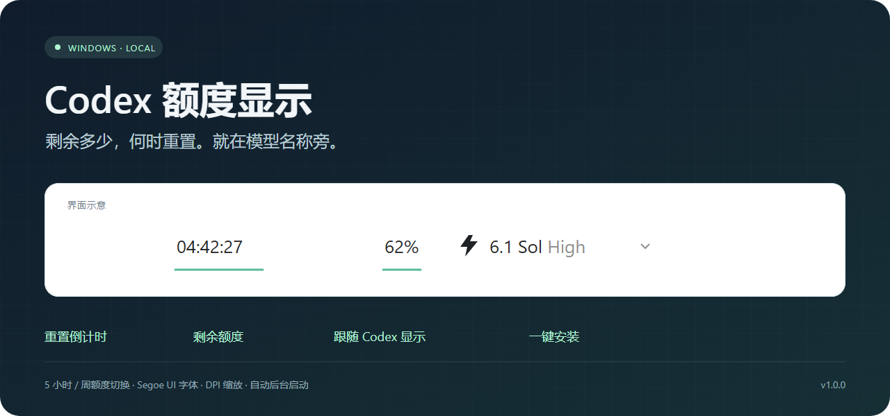
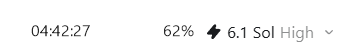

  

<h1 align="center">Codex 额度显示</h1>

在模型选择旁，一眼看清剩余额度和重置时间。

  <a href="https://github.com/777channel/codex-quota-widget/releases/latest">下载安装包</a>
  · <a href="https://github.com/777channel/codex-quota-widget/tree/codex/quota-widget">项目源码与完整中文说明</a>

一个适用于 Windows 的本地额度显示小工具：将**额度重置倒计时**和**剩余百分比**固定在 Codex 模型名称附近，随 Codex 窗口显示。

## 实际效果

  

实际截图按原始尺寸展示。图中的 `04:42:27` 表示距离当前额度周期重置的时间，`62%` 表示剩余额度；数值随使用情况变化。

## 功能

- 支持 5 小时额度 / 周额度切换，悬停查看两个周期的信息。
- 登录 Windows 后自动后台运行，打开 Codex 并切到前台时显示。
- 使用 Segoe UI 常规字体和透明抗锯齿渲染，支持 DPI 缩放。
- 位置随 Codex 窗口移动，调整后可固定并保存。
- 安装包内置运行环境，无需另装 Python，支持标准卸载。

## 安装使用

1. 从 [下载页面](https://github.com/777channel/codex-quota-widget/releases/latest) 下载 `Codex额度显示-安装.exe`，约 15 MB。
2. 双击安装，完成后自动启动；支持 Windows 10 / 11 x64，无需管理员权限。
3. 打开已登录的 Codex 桌面客户端，切到前台并等待首次读取。
4. 位置不合适时，在额度文字上右键选择“调整位置”，移动后再选择“固定当前位置”。

双击额度文字可切换周期，右键可立即刷新或退出。卸载入口位于 Windows“已安装的应用”或开始菜单的“Codex额度显示”文件夹。

## 项目分支

| 分支 | 内容 |
| --- | --- |
| `main` | 项目展示首页、介绍图和实际效果截图 |
| [`codex/quota-widget`](https://github.com/777channel/codex-quota-widget/tree/codex/quota-widget) | 从主分支创建的完整项目，包含源码、安装器、构建脚本、中文文档与版本记录 |

完整使用说明和常见问题见 [项目中文介绍](https://github.com/777channel/codex-quota-widget/blob/codex/quota-widget/README.md)，打包方法见 [构建文档](https://github.com/777channel/codex-quota-widget/blob/codex/quota-widget/docs/BUILD.md)。

本项目为独立的本地辅助工具，非 OpenAI 官方项目。读取额度依赖本机 Codex 接口；客户端更新或布局变化后可能需要适配或重新定位。
